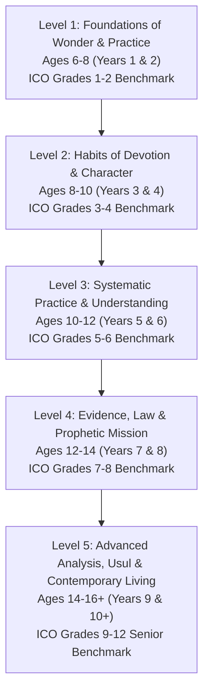

# 01 — Scope and Sequence: 5-Level Curriculum (Ages 6 to 16+)

> **Overview**: A comprehensive, developmentally staged pedagogical master plan benchmarked against all 12 grades of the International Curricula Organization (ICO) Islamic Studies series. Spans from **Age 6 all the way to Age 16+**, structured into **5 Progressive Levels** that match the 5 learner tracks in the LMS app. Specially adapted for the **Ash'ari creed**, **Maliki madhhab**, and **Junaydi tazkiyah**, with systematic integration of the cross-cutting **"Other Scholars Say"** comparative framework.

---

## 1. Pedagogical Architecture: The 5 App Levels (Ages 6 to 16+)

Rather than artificially compressing 12 grades into early childhood, the curriculum spans the natural developmental journey from primary school to young adulthood across **5 distinct Levels** (2 years per level):

### Level Overview & Pacing

| App Level | Target Age | School Stage | ICO Benchmark | Weekly Pacing | Annual Hours (36 wks) | Core Focus |
|---|---|---|---|---|---|---|
| **Level 1** | **Ages 6–8** | Early Primary (Years 1–2) | Grades 1–2 | 5 × 20 min | 60 h/yr (120 h total) | Wonder of creation, Shahaadah, sensory wudu/salah habituation, Prophet's childhood. |
| **Level 2** | **Ages 8–10** | Upper Primary (Years 3–4) | Grades 3–4 | 5 × 30 min | 90 h/yr (180 h total) | 6 Pillars of Iman, conditions of prayer, 2/3/4 rak'ahs, Cave Hira, Nawawi 1–10, recognizing 4 Imams. |
| **Level 3** | **Ages 10–12** | Pre-Adolescent (Years 5–6) | Grades 5–6 | 4 × 40 min | 96 h/yr (192 h total) | *Ibn 'Ashir* (Creed & Taharah), Sujud as-Sahw clinic, Sawm/Zakah basics, completing Juz' 30. |
| **Level 4** | **Ages 12–14** | Early Adolescent / Puberty (Years 7–8) | Grades 7–8 | 3 × 70 min | 126 h/yr (252 h total) | Sanusi 20 attributes, Zakah calculations, travel fiqh, battles, Shama'il (*Al-Shifa*), Four Caliphs, Nawawi 1–30. |
| **Level 5** | **Ages 14–16+** | Senior High / Young Adult (Years 9–10+) | Grades 9–12 | 3 × 90 min | 162 h/yr (324 h total) | Epistemology, Usul al-Fiqh (*Al-Waraqat*), Mu'amalat (Riba, Islamic banking), Family Law & Mirath, Modern Ideologies. |
| **Total** | **Ages 6–16+** | **Full K–12 Spectrum** | **Grades 1–12** | | **1,068 Total Hours** | Complete, unhurried, rigorous Islamic scholarship across 10 years! |

---

## 2. Classical Text Spine Across the 5 Levels

Each of the 5 Levels is anchored in classical didactic texts of the Western Islamic tradition, graduated by intellectual maturity:

| App Level | Target Age | Memorisation (*Matn*) | Classical Reference Text |
|---|---|---|---|
| **Level 1** | Ages 6–8 | *'Aqidat al-'Awamm* (Lines 1–10), short du'as | *Mukhtasar al-Akhdari* (Taharah basics) |
| **Level 2** | Ages 8–10 | *'Aqidat al-'Awamm* (Lines 11–25), Nawawi 1–10 | *Matn al-'Ashmawiyyah* (Salah conditions & acts) |
| **Level 3** | Ages 10–12 | *Ibn 'Ashir* (Creed & Wudu: lines 11–35), Nawawi 11–20 | *Muqaddimat al-Risalah* of Ibn Abi Zayd al-Qayrawani |
| **Level 4** | Ages 12–14 | *Ibn 'Ashir* (Salah, Fasting, Zakah), *Al-Burdah*, Nawawi 21–30 | Sanusi's *Umm al-Barahin*, Qadi 'Iyad's *Al-Shifa*, *Al-Risalah* |
| **Level 5** | Ages 14–16+ | *Ibn 'Ashir* (Tazkiyah), *Jawharat al-Tawhid* selections, Nawawi 31–42 | *Bidayat al-Mujtahid* (Ibn Rushd), *Al-Waraqat* (Juwayni), *Al-Iqtisad* (Ghazali) |

---

## 3. The 7 Curricular Strands Across the 5 Levels

1. **'Aqidah (Ash'ari Creed)**:
   * *Level 1*: Wonder of Allah the Creator (*Al-Khaliq*), loving Allah and His Messenger ﷺ.
   * *Level 2*: The 6 Pillars of Iman, Angels of Light, Heavenly Books, Divine Transcendence (*Tanzih*).
   * *Level 3*: The 3 Judgments of the Mind (*Wajib*, *Mustahil*, *Ja'iz*), rejecting anthropomorphism.
   * *Level 4*: The 20 Necessary Attributes (*Nafsiyyah*, *Salbiyyah*, *Ma'ani*, *Ma'nawiyyah*), Infallibility of Prophets (*'Ismah*).
   * *Level 5*: Epistemology (*Hiss*, *'Aql*, *Wahy*), *Kasb* and *Qadar*, refuting Materialism, Scientism, Atheism, and historical sects (Mu'tazila, Khawarij).
2. **Qur'an & 'Ulum al-Qur'an (Hafs 'an 'Asim with Warsh Awareness)**:
   * *Level 1*: Short surahs (114 to 102), makharij, respecting the Mushaf.
   * *Level 2*: Middle Juz' 'Amma (101 to 86), natural prolongation (*Madd Tabee'ee*), heavy letters (*Tafkhim*).
   * *Level 3*: Completing Juz' 30 (85 to 78), rules of Noon Sakinah & Tanween, Qalqalah.
   * *Level 4*: Juz' 29 (Tabarak), Meem Sakinah, all secondary Madd rules (*Wajib*, *Ja'iz*, *Lazim*).
   * *Level 5*: Surah Al-Kahf, Surah Yasin, 'Ulum al-Qur'an (Preservation, Uthmanic codex, *I'jaz*, Makki/Madani), *Tuhfat al-Atfal*, and phonological awareness of Warsh 'an Nafi'.
3. **Hadith & Mustalah**:
   * *Level 1*: 3 short prophetic sayings on cleanliness, steadfastness, and kind words.
   * *Level 2*: Imam an-Nawawi's *40 Hadith* (Hadiths 1–10: Intentions, Hadith Jibril, Halal/Haram).
   * *Level 3*: Nawawi's *40 Hadith* (Hadiths 11–20: Leaving doubt, modesty, anger control).
   * *Level 4*: Nawawi's *40 Hadith* (Hadiths 21–30: Divine justice, adhering to Sunnah, purification).
   * *Level 5*: Nawawi's *40 Hadith* (Hadiths 31–42: Renunciation, brotherhood, repentance), Mustalah al-Hadith (Isnad, Matn, Sahih, Hasan, Da'if), and Muwatta' selections.
4. **Seerah, Shama'il & Islamic History**:
   * *Level 1*: Year of the Elephant, Aminah & Halimah, the Orphan child ﷺ, Al-Amin.
   * *Level 2*: Rebuilding the Ka'bah, Black Stone arbiter, Marriage to Khadijah, Cave Hira & "Iqra'!".
   * *Level 3*: Mount Safa, early persecution, Boycott of Shi'b Abi Talib, Abyssinia, Year of Sorrow, Ta'if.
   * *Level 4*: Isra' wal-Mi'raj, Pledges of 'Aqabah, Hijrah, Badr, Uhud, Trench, Hudaybiyyah, Fath Makkah, Farewell Hajj, Shama'il (*Al-Shifa*), Four Caliphs.
   * *Level 5*: Umayyad, Abbasid, Andalusian, North/West African (Fes, Timbuktu), and Ottoman milestones; Muslim contributions to science, medicine, and optics; colonialism and contemporary Muslim world.
5. **Fiqh & Usul (Maliki Madhhab)**:
   * *Level 1*: Taharah habits, bathroom manners (*Istinja*), step-by-step wudu, 5 prayers & postures (Sadl).
   * *Level 2*: Conditions of Salah (*Shurut*), praying 2/3/4 rak'ahs, invalidators of wudu (*Nawaqid*), caring for water.
   * *Level 3*: 7 Fara'id of wudu (*Ibn 'Ashir*), Ghusl, Tayammum with *Sa'id*, Sujud as-Sahw (*Qabli* vs *Ba'di*), Sawm basics, Jumu'ah.
   * *Level 4*: Detailed Sawm (*Kaffarah* & *Fidyah*), Zakah calculation (Nisab, 2.5%, gold/currency), travel prayers (Qasr & Jam'), Masah on khuffs/casts, Hajj & 'Umrah pillars.
   * *Level 5*: Usul al-Fiqh (*Al-Waraqat*, 5 Ahkam, *'Amal Ahl al-Madinah*, Ijma', Qiyas, Maslahah), Maqasid al-Shari'ah, Fiqh al-Mu'amalat (Riba, Gharar, Maysir, Murabaha, Mudarabah, Islamic banking), Family Law (Nikah, Mahr, divorce) & Mirath (Inheritance shares).
6. **Akhlaq, Adab & Tazkiyah**:
   * *Level 1*: Spreading Salam, eating/drinking manners, honoring parents, caring for toys.
   * *Level 2*: Dutifulness to parents (*Birr al-Walidayn*), classroom adab, kindness to animals and nature.
   * *Level 3*: Sincerity (*Ikhlas*) vs Ostentation (*Riya'*), guarding the tongue (backbiting & slander).
   * *Level 4*: Modesty (*Haya'*), lowering the gaze, Islamic brotherhood, social justice, standing for truth.
   * *Level 5*: Junaydi Tazkiyah (*Ibn 'Ashir*): Curing heart diseases (envy, arrogance, vanity, love of praise), sincere repentance (*Tawbah*), environmental stewardship (*Khilafah*), digital ethics, and civic leadership.
7. **Adab al-Ikhtilaf (Comparative Sunni Appreciation)**:
   * *Level 1*: **Awareness & Love** — Muslims pray in slightly different ways; all follow the Sunnah. Stories of the 4 Imams' friendship.
   * *Level 2*: **Recognition** — The 4 Imams by name and city; raising hands; saying Amin.
   * *Level 3*: **Identification** — 4-school comparative tables for wudu, prayer, and fasting; Ash'ari & Maturidi creed harmony.
   * *Level 4*: **Reasons** — *Why* scholars differ (hadith reach, linguistic meaning, *'Amal Ahl al-Madinah*, qiyas); Athari approach to attributes (*Tafwid*).
   * *Level 5*: **Evidence & Analysis** — *Bidayat al-Mujtahid* case studies, taqlid, talfiq, contemporary fatwa councils, historical sects, and confident living in the modern world.

---

## 4. App Level Integration

In the Islamic Studies LMS application, the student and parent interface provides seamless switching between these **5 Levels**:
* **Level 1 (Ages 6–8)**: Playful comic cards, tactile emoji mascots, audio-guided wudu/salah drills.
* **Level 2 (Ages 8–10)**: Illustrated story handouts, gamified quizzes, habit tracker badges.
* **Level 3 (Ages 10–12)**: Classical matn lines in Arabic, comparative tables, "Fiqh Clinic" dilemma quizzes.
* **Level 4 (Ages 12–14)**: Extended thematic handouts, primary source extracts, legal proof analyses *(anchored by existing 10yr materials)*.
* **Level 5 (Ages 14–16+)**: Scholarly seminar modules, comparative jurisprudence, contemporary ethics debriefs *(anchored by existing 13yr materials)*.
