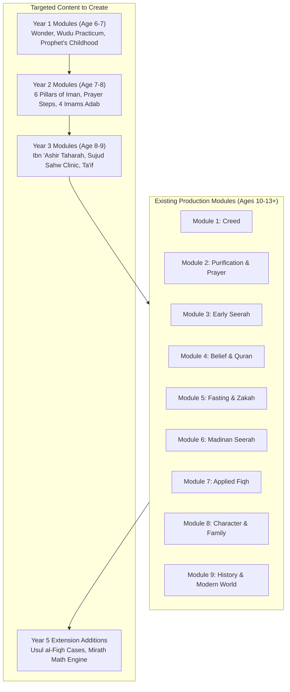

# 04 — Existing Modules Map & Content Gap Analysis

> **Document Purpose**: Audits the 9 existing production modules in the LMS codebase against the new 5-Year Ash'ari-Maliki Syllabus, showing where current content fits, how existing 10yr and 13yr tracks align, and detailing the exact content gaps required for future lesson writing.

---

## 1. Architectural Fit of the 9 Existing LMS Modules

The repository currently contains 9 fully developed curriculum modules with teacher slides, 10yr student handouts, 13yr student handouts, and question banks. 

A review of their linguistic register and pedagogical depth reveals that **the existing modules were authored primarily for intermediate (age 10) and secondary (age 13+) learners**. Consequently, they fit naturally into **Year 4 Core, Year 5 Core, and the Extension (13+) Tracks** of the new 5-Year Syllabus:

| Existing LMS Module | Focus & Content in Codebase | Syllabus Year Alignment | Existing Track Mapping |
|---|---|---|---|
| **`1 — Foundations of Belief`** | Epistemology, 20 Attributes (Sanusi), Tanzih, Tafwid/Ta'wil, Angels, Books, Kalam Nafsi, Prophethood, Qadar & Kasb, Maliki Fiqh methodology. | **Year 4 (Term 1) & Year 5 (Term 1)** | `handout_10yr` → Year 4 Core `handout_13yr` → Year 5 / Extension |
| **`2— Purification & Prayer`** | Istighna/Iftiqar, Asbab, Amal Ahl al-Madinah, Taharah, Water classification, Wudu 7 fara'id, 4-schools table, Ghusl, Tayammum, Sadl vs Qabd. | **Year 3 (Term 2) & Year 4 (Term 2)** | `handout_10yr` → Year 3/4 Core `handout_13yr` → Year 4 / Extension |
| **`3 — Seerah The Early Life`** | Jahiliyyah crisis, Hanifs, Fitrah, Infallibility, Hira, Kalam, Secret dawah, Open call, Ta'if, Amal Ahl al-Madinah. | **Year 3 (Terms 1 & 2)** | `handout_10` → Year 3 Core `handout_13` → Year 4 / Extension |
| **`4— Deepening Belief & Quran`** | Intention, Sincerity, Kasb, Oral/Written preservation, Uthmanic codex, Analytical Tafsir of Al-Ikhlas & Al-'Asr. | **Year 3 (Term 3) & Year 5 (Term 1)** | `handout_10yr` → Year 3/4 Core `handout_13yr` → Year 5 / Extension |
| **`5— Fasting Zakah & Community`** | Fiqh of Sawm, One intention rule, Taraweeh 36 rak'ahs, Zakah on wealth/nisab, No zakah on worn jewelry, Social solidarity. | **Year 4 (Terms 1 & 2)** | `handout_10yr` → Year 4 Core `handout_13yr` → Year 4 / Extension |
| **`6— Seerah Madinah Community`** | Hijrah, Building the Mosque, Mu'akhah, Charter of Madinah, Badr, Uhud, Ahzab, Hudaybiyyah, Fath Makkah. | **Year 4 (Terms 2 & 3)** | `handout_10yr` → Year 4 Core `handout_13yr` → Year 4 / Extension |
| **`7— Applied Fiqh & Everyday`** | Halal/Haram food, slaughter, financial transactions, Riba, Gharar, modern Islamic banking, bioethics, marriage/nikah. | **Year 5 (Term 2)** | `student_handout_10` → Year 5 Core `student_handout_13` → Year 5 / Extension |
| **`8— Character Society & Family`** | Birr al-Walidayn, rights of spouses, children, neighbors, environmental stewardship, digital ethics, civic duties. | **Year 4 (Term 3) & Year 5 (Term 2)** | `handout_10yr` → Year 4 Core `handout_13yr` → Year 5 / Extension |
| **`9— Seerah, History & Living`** | Farewell Hajj, Demise of Prophet ﷺ, Four Caliphs, Umayyads, Abbasids, Andalus, West Africa, Ottomans, contemporary dawah. | **Year 4 (Term 3) & Year 5 (Terms 1 & 3)** | `handout_10yr` → Year 4 Core `handout_13yr` → Year 5 / Extension |

---

## 2. Content Gap Analysis: What Needs to Be Built in Phase 2?

Because the existing LMS modules are designed for ages 10 and 13+, **the primary content gap lies in the foundational, play-based, and early-childhood pedagogy for Ages 6–9 (Years 1, 2, and 3)**.

### Gap Area A: Early Childhood Foundational Modules (Years 1 & 2 — Ages 6–8)
Young learners (ages 6–8) require short, vibrant, story-driven, and sensory materials rather than dense theological essays.
* **Gap 1: "Little Believers: Wonder, Creation & The Shahaadah" (Year 1)**
  * *Needs*: Sensory activity guides, picture flashcards of nature, coloring sheets of the Shahaadah in Arabic, rhyming poems for the 5 Pillars of Islam.
* **Gap 2: "My First Wudu & Prayer Practicum" (Year 1)**
  * *Needs*: Step-by-step visual photographic posters of the 7 Fara'id of wudu (including rubbing and whole head wipe); posture adjustment guides for Sadl standing.
* **Gap 3: "Stories of the Young Prophet ﷺ and the Four Imams" (Years 1 & 2)**
  * *Needs*: Narrative storybooks covering the Year of the Elephant, the Orphan of Makkah, Al-Amin, and the friendship between Imam Malik, Abu Hanifa, Al-Shafi'i, and Ahmad.
* **Gap 4: "Pillars of Faith & Daily Habits" (Year 2)**
  * *Needs*: Hands-on crafts for the 6 Pillars of Iman, bedroom Adhkar sticker charts, and comic strips on honesty, kindness to animals, and water conservation.

### Gap Area B: Systematic Primary Matn Modules (Year 3 — Age 8–9)
Learners transitioning into systematic fiqh need bridged matn resources:
* **Gap 5: "Ibn 'Ashir Junior: The 7 Pillars of Wudu & Purification with Sa'id"**
  * *Needs*: Simplified Arabic-English text of lines 11–35 of *Al-Murshid al-Mu'in*, interactive drills on *Qabli* and *Ba'di* prostrations of forgetfulness, and the 4-schools wudu comparison table.
* **Gap 6: "The Prophet's Struggle: From Safa to the Valley of Ta'if"**
  * *Needs*: Narrative chapter on early Makkan persecution, the boycotted valley, the migration to Abyssinia, and the forgiving prayer of Ta'if.

### Gap Area C: Supplementary Specialized Extension Modules (Year 5 — Age 10–11)
To complete full ICO high-school equivalence:
* **Gap 7: "The Junior Jurist: Introduction to Usul al-Fiqh & Maqasid"**
  * *Needs*: Visual guide to *Al-Waraqat*, real-life legal case studies on the 5 Maqasid, and how Imam Malik utilized *'Amal Ahl al-Madinah*.
* **Gap 8: "Inheritance (Mirath) Math Workshop"**
  * *Needs*: Interactive calculation worksheets for primary Qur'anic estate shares (1/2, 1/4, 1/8, 2/3, 1/3, 1/6).

---

## 3. Recommended Roadmap for Future Content Generation

This mapping guarantees that none of the excellent work already built in Modules 1–9 is wasted; rather, it anchors the upper years of the 5-Year Syllabus, while establishing a clear, prioritized blueprint for future foundational lesson creation.
