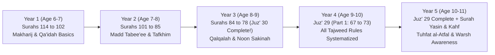

# 05: Hifz, Tajweed, & Classical Matn Track: 5-Year Master Plan

> **Scope**: A comprehensive 5-year Qur'anic memorisation, recitation, Tajweed, classical didactic poetry (*Matn*), and Prophetic Hadith progression designed for ages 6–11.  
> **Primary Recitation**: **Hafs 'an 'Asim via the Shatibiyyah route**  
> **Cultural Literacy**: Awareness of **Warsh 'an Nafi' via the Azraq route** (the historical recitation of the Maliki school across North and West Africa).  
> **Daily Time Budget**: 10–15 minutes of home revision (*Muraja'ah*) and new memorisation (*Sabaq*) scheduled alongside weekly classroom lessons.

---

## 1. 5-Year Qur'anic Memorisation & Tajweed Progression

---

### Year 1: Foundations of Articulation (Age 6–7)
*Focus: Phonological clarity, love for the Qur'an, and short surahs.*

* **Memorisation Target**: 14 Surahs from the end of the Qur'an:
  1. Surah Al-Fatihah (1)
  2. Surah An-Nas (114)
  3. Surah Al-Falaq (113)
  4. Surah Al-Ikhlas (112)
  5. Surah Al-Masad (111)
  6. Surah An-Nasr (110)
  7. Surah Al-Kafirun (109)
  8. Surah Al-Kawthar (108)
  9. Surah Al-Ma'un (107)
  10. Surah Quraysh (106)
  11. Surah Al-Fil (105)
  12. Surah Al-Humazah (104)
  13. Surah Al-'Asr (103)
  14. Surah At-Takathur (102)
* **Tajweed Principles (Practical & Sensory)**:
  * Proper pronunciation of throat letters (*Huruf Halqiyyah*): ء, هـ, ع, ح, غ, خ.
  * Emphatic/Heavy letters vs Soft letters: Differentiating between س and ص, ت and ط, د and ض.
  * Basic stop signs (*Waqf*): Stopping on a sukun, holding breath.
* **Classical Matn & Hadith Targets**:
  * *'Aqidat al-'Awamm*: Lines 1–4 (Bismillah, Praise, Affirming Divine Existence).
  * 3 Short Prophetic Phrases:
    1. *"Al-Tahuru shatr al-iman"* (Cleanliness is half of faith).
    2. *"Qul: Amantu billahi thumma-staqim"* (Say: I believe in Allah, and then remain steadfast).
    3. *"Al-Kalimatu al-tayyibatu sadaqah"* (A kind word is charity).
* **Daily Adhkar**:
  * Morning and evening: 3× Surah Al-Ikhlas, Al-Falaq, An-Nas.
  * Before eating: *"Bismillah"*; After eating: *"Alhamdulillah"*.
  * Entering and exiting the home: *"Bismillahi tawakkaltu 'alallah"*.

---

### Year 2: Rhythmic Elongation & Vowel Purity (Age 7–8)
*Focus: Mid-section of Juz' 'Amma, natural madd, and prayer invocations.*

* **Memorisation Target**: 16 Surahs:
  1. Surah Al-Qari'ah (101)
  2. Surah Al-'Adiyat (100)
  3. Surah Az-Zalzalah (99)
  4. Surah Al-Bayyinah (98)
  5. Surah Al-Qadr (97)
  6. Surah Al-'Alaq (96)
  7. Surah At-Teen (95)
  8. Surah Ash-Sharh (94)
  9. Surah Ad-Duha (93)
  10. Surah Al-Layl (92)
  11. Surah Ash-Shams (91)
  12. Surah Al-Balad (90)
  13. Surah Al-Fajr (89)
  14. Surah Al-Ghashiyah (88)
  15. Surah Al-A'la (87)
  16. Surah At-Tariq (86)
* **Tajweed Principles**:
  * **Al-Madd al-Tabee'ee (Natural Prolongation)**: Holding vowels for exactly 2 counts (*Alif*, *Waw*, *Ya*).
  * **Tafkhim & Tarqiq (Heavy and Light Letters)**: The 7 permanently heavy letters (*Khussa Daghtin Qiz*: خ, ص, ض, غ, ط, ق, ظ).
  * The rules of the letter **Ra' (ر)**: When it is pronounced heavy (fathah/dammah) vs light (kasrah).
* **Classical Matn & Hadith Targets**:
  * *'Aqidat al-'Awamm*: Lines 5–25 (The Prophets, Angels, and Heavenly Books).
  * **Imam an-Nawawi's 40 Hadith**: Hadiths 1 through 10 (including Intentions, Hadith Jibril, Five Pillars, and Leaving Doubt).
* **Daily Adhkar**:
  * The Complete Tashahhud (Sayyidina 'Umar formulation) and Salawat Ibrahimiyyah.
  * Sleeping du'a: *"Bismika Rabbi wada'tu janbi..."*.
  * Waking du'a: *"Alhamdulillahil-ladhi ahyana ba'da ma amatana wa ilayhin-nushur"*.

---

### Year 3: Juz' 'Amma Completion & The Rules of Noon (Age 8–9)
*Focus: Upper Juz' 'Amma, completing the 30th Juz', Qalqalah, and Ghunnah.*

* **Memorisation Target**: 8 Long Surahs (Completing Juz' 30!):
  1. Surah Al-Burooj (85)
  2. Surah Al-Inshiqaq (84)
  3. Surah Al-Mutaffifin (83)
  4. Surah Al-Infitar (82)
  5. Surah At-Takwir (81)
  6. Surah 'Abasa (80)
  7. Surah An-Nazi'at (79)
  8. Surah An-Naba' (78)
* **Tajweed Principles**:
  * **The 4 Rules of Noon Sakinah & Tanween**:
    1. **Al-Izhar al-Halqi** (Clear Pronunciation before 6 throat letters: ء, هـ, ع, ح, غ, خ).
    2. **Al-Idgham** (Merging into *Yarmalun*: with Ghunnah in ي, ن, م, و; without Ghunnah in ل, ر).
    3. **Al-Iqlab** (Conversion to Meem before the letter ب with ghunnah).
    4. **Al-Ikhfa' al-Haqiqi** (Concealment with nasalization before the remaining 15 letters).
  * **Qalqalah (Echoing sound)** on the 5 letters of *Qutbu Jaddin* (ق, ط, ب, ج, د) when accompanied by a Sukun.
* **Classical Matn & Hadith Targets**:
  * *Ibn 'Ashir (Al-Murshid al-Mu'in)*: Lines 11–35 (The Creed and the 7 Obligations of Wudu in Arabic).
  * **Imam an-Nawawi's 40 Hadith**: Hadiths 11 through 20 (including Loving for your Brother, Speaking Good, and Not Becoming Angry).
* **Daily Adhkar**:
  * Ayat al-Kursi (Surah Al-Baqarah 2:255) recited after every fard prayer.
  * The Tasbih Fatimi: 33 SubhanAllah, 33 Alhamdulillah, 34 Allahu Akbar.
  * The Adhan response and the post-Adhan du'a with *Wasila*.

---

### Year 4: The 29th Juz' (Tabarak) & Theoretical Tajweed (Age 9–10)
*Focus: Deepening endurance with longer Surahs, systematic tajweed, and the Shama'il.*

* **Memorisation Target**: Selections of Juz' 29 (6 Surahs):
  1. Surah Al-Mulk (67)
  2. Surah Al-Qalam (68)
  3. Surah Al-Haqqah (69)
  4. Surah Al-Ma'arij (70)
  5. Surah Nuh (71)
  6. Surah Al-Jinn (72)
* **Recitation Target**: Fluency across the entire 29th Juz' (Juz' Tabarak).
* **Tajweed Principles**:
  * **Rules of Meem Sakinah**:
    1. *Ikhfa' Shafawi* (before the letter ب).
    2. *Idgham Shafawi / Mithlayn* (before another م).
    3. *Izhar Shafawi* (before all remaining letters, with caution before و and ف).
  * **Rules of Madd (Prolongation)**:
    * *Madd Wajib Muttasil* (Mandatory connected madd - 4 to 5 counts).
    * *Madd Ja'iz Munfasil* (Permissible separated madd - 4 counts in Hafs Shatibiyyah).
    * *Madd 'Arid lis-Sukun* (Incidental madd upon stopping - 2, 4, or 6 counts).
    * *Madd Lazim* (Compulsory madd - 6 full counts).
* **Classical Matn & Hadith Targets**:
  * *Ibn 'Ashir*: Lines 36–70 (Fiqh of Salah, Sawm, and Zakah).
  * *Qasidat al-Burdah* (Imam al-Busiri): Opening 15 lines celebrating prophetic character.
  * **Imam an-Nawawi's 40 Hadith**: Hadiths 21 through 30 (including Steadfastness, Hadith Qudsi on Justice, and Adhering to the Sunnah).
* **Daily Adhkar**:
  * The Morning & Evening Fortress (*Adhkar al-Sabah wal-Masa'*): Complete authentic set.
  * Supplications for travel (*Du'a al-Safar*) and entering market places.

---

### Year 5: Extended Surahs, Capstone Matn, & Warsh Awareness (Age 10–11)
*Focus: Surah Al-Kahf, Surah Yasin, completion of Juz' 29, and analytical comparative tajweed.*

* **Memorisation Target**:
  1. Completion of Juz' 29: Surah Al-Muzzammil (73), Al-Muddaththir (74), Al-Qiyamah (75), Al-Insan (76), Al-Mursalat (77).
  2. Surah Yasin (36: complete).
  3. Surah Al-Kahf (18: Verses 1-60, protecting against the trials of Dajjal).
* **Tajweed Principles & The Science of Qira'at**:
  * Completion of *Tuhfat al-Atfal* (the classic didactic poem on tajweed rules).
  * Understanding the 10 Mutawatir Qira'at: Transmission chains, regional dominance.
  * **Awareness of Warsh 'an Nafi'**:
    * The legacy of Imam Nafi' al-Madani (the Imam of recitation in Madinah, whom Imam Malik studied under).
    * Key differences between Hafs and Warsh:
      * *Al-Naql* (transfer of vowels before a hamzah).
      * *Taghlidh al-Lam* (heavy pronunciation of Lam after ص, ض, ط).
      * *Tarkis al-Ra'* (thinning of Ra' after a kasrah or ya' sakinah).
      * *Ibdal al-Hamzah* (converting hamzahs into long vowels).
* **Classical Matn & Hadith Targets**:
  * *Ibn 'Ashir*: Closing lines on Tazkiyah (Purification of the Heart from Envy, Vanity, and Ostentation).
  * *Jawharat al-Tawhid* (Imam al-Laqani): Selected 25 lines on the Attributes of Allah and Prophethood.
  * *Al-Waraqat* (Imam al-Juwayni): Opening definitions of Usul al-Fiqh.
  * **Imam an-Nawawi's 40 Hadith**: Hadiths 31 through 42 (completion of the text).
* **Daily Adhkar**:
  * Reciting Surah Al-Kahf every Friday.
  * Complete Istighfar Sayyid (*Sayyid al-Istighfar*).
  * Sending 100 Salawat upon the Prophet ﷺ on Friday evenings.

---

## 2. Weekly Memorisation & Review Schedule (Template)

| Day of Week | Classroom Slot (integrated) | Home Practice Slot (10–15 min) |
|---|---|---|
| **Monday** | New Lesson / Matn Introduction | **Sabaq (New Lesson)**: Memorise 2–3 new ayahs / 2 lines of matn. |
| **Tuesday** | Tajweed correction & Recitation drill | **Sabqi (Recent Review)**: Review yesterday's new lines + past 5 days. |
| **Wednesday** | Vocabulary & Meaning analysis | **Manzil (Distant Review)**: Recite 1 complete past surah from memory. |
| **Thursday** | Oral examination with teacher | **Combined Drill**: Recite new lesson to parents without errors. |
| **Friday** | Choral recitation / Adhkar & Salawat | **Friday Sunnah**: Recite Surah Al-Kahf / Surahs of protection. |
| **Weekend** | Rest / Family review | Light revision while traveling or in nature. |

---

## 3. Capstone Certification Milestones

1. **Junior Hafiz of Juz' 'Amma** (End of Year 3): Awarded upon reciting the entirety of Juz' 30 from memory with accurate Hafs tajweed rules and basic translation comprehension.
2. **Keeper of the Classical Matn** (End of Year 4): Awarded upon reciting the Creed and Fiqh sections of *Ibn 'Ashir* and the first 30 Hadiths of Imam an-Nawawi without prompting.
3. **Master of the Prophetic Tradition** (End of Year 5): Awarded upon completing the full 42 Hadiths of Imam an-Nawawi, Surah Yasin, Surah Al-Kahf, and the complete text of *Tuhfat al-Atfal*, certifying full readiness for advanced Islamic scholarship!
