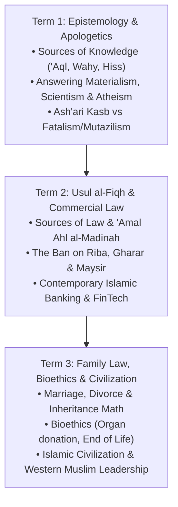

# Level 5 Syllabus: Advanced Analysis, Usul & Contemporary Living (Ages 14–16+)

> **App Track**: **Level 5** (`level5`)  
> **Target Learner**: Ages 14–16+ (Senior High / Pre-University / Adolescents)  
> **ICO Benchmarks Absorbed**: Grades 9, 10, 11, and 12 (senior secondary capstone)  
> **Weekly Schedule**: 3 seminar sessions × 90 minutes = 270 min/week (162 h/year)  
> **Classical Text Spine**: *Jawharat al-Tawhid* (Imam al-Laqani), *Bidayat al-Mujtahid* (Ibn Rushd), *Al-Waraqat* (Imam al-Juwayni), and *Ibn 'Ashir* (Tazkiyah section)  
> **Riwayah**: Hafs 'an 'Asim (Advanced Tajweed, *Tuhfat al-Atfal*, and phonological awareness of Warsh 'an Nafi')

---

## Pedagogical Vision for Level 5 (Ages 14–16+)

At ages 14–16+, students undergo rapid intellectual and moral maturation. They encounter complex secular ideologies, university-level intellectual questions, economic realities, and social dilemmas. Level 5 transforms Islamic Studies from simple rules into a **rigorous, intellectually empowering worldview** rooted in classical Sunni scholarship:

---

## Term 1: Epistemology, Divine Decree, & Contemporary Apologetics (Weeks 1–12)

### Unit 5.1: Epistemology: Sources of Knowledge & Defending Revelation (Weeks 1–4)
* **Strand**: 'Aqidah (Ash'ari) & Philosophy
* **Session Allocation**: 12 seminar sessions × 90 min = 18 hours
* **Classical Reference**: *Jawharat al-Tawhid* (Lines 20–45) / *Al-Iqtisad fil-I'tiqad* (Imam al-Ghazali).
* **Learning Outcomes (Ages 14–16+)**:
  1. The student deconstructs modern epistemological skepticism, defining the 3 legitimate channels of knowledge:
     * **Al-Hiss al-Salim (Sound Senses)**: The domain of empirical science and observation.
     * **Al-'Aql al-Sarih (Pure Reason)**: Necessary logical principles (e.g. non-contradiction, the whole is greater than its part).
     * **Al-Khabar al-Sadiq (Veracious Report)**: Mass-transmitted historical knowledge (*Tawatur*) and Divine Revelation (*Wahy*).
  2. The student critiques the dogma of **Scientism** (the claim that only empirical science gives truth), showing that the scientific method itself rests on unprovable philosophical assumptions (the uniformity of nature, reliability of human consciousness, reality of logic).
  3. The student defends the rational necessity of Prophethood and miracles (*Mu'jizat*) as divine credentials.
* **Ash'ari Creed Flag**: Affirming that the existence of the Creator is rationally provable through reflection on the created universe (*Nazar wa Istidlal*), which classical scholars declared the first obligation upon the responsible mind (*Mukallaf*).
* **Qur'an & Hadith Evidence**: Surah Al-Anbiya' (21:22: *"Had there been within the heavens and earth gods besides Allah, they both would have been ruined"*); Surah At-Tur (52:35–36).
* **Seminar Workshop**: "Defending Truth in the Digital Age": Analyzing how deepfakes and algorithmic echo chambers demonstrate why Islam developed the world's most rigorous transmission science (*Isnad* and *Tawatur*).
* **Hifz & Texts**: *Jawharat al-Tawhid* Lines 1–25. Surah Al-Kahf (Verses 1–30).

---

### Unit 5.2: Divine Decree (Qadar), Human Choice (Kasb), & The Problem of Evil (Weeks 5–8)
* **Strand**: 'Aqidah (Ash'ari)
* **Session Allocation**: 12 seminar sessions × 90 min = 18 hours
* **Classical Reference**: *Al-Risalah* of Ibn Abi Zayd (Muqaddimah) / *Al-Tamhid* of Qadi Abu Bakr al-Baqillani.
* **Learning Outcomes (Ages 14–16+)**:
  1. The student articulates the 4 Stages of Qadar:
     * *Al-'Ilm* (Allah's eternal, uncreated Knowledge of all events).
     * *Al-Kitabah* (The recording in the Preserved Tablet / *Al-Lawh al-Mahfuz*).
     * *Al-Mashi'ah* (The all-encompassing Divine Will; nothing exists without His permission).
     * *Al-Khalq* (Allah creates all entities and acts; no secondary creator exists).
  2. The student defines the Ash'ari doctrine of **Kasb (Acquisition)**: Allah creates the power and the act at the moment of choice, while the human directs their conscious intent (*Qasd*), establishing genuine moral and legal accountability.
  3. The student resolves the "Problem of Evil and Suffering": Earth is not Paradise; it is *Dar al-Imtihan* (the testing realm). Pain and suffering serve as spiritual purifiers, tests of faith, catalysts for compassion, and are fully redressed in the perfect justice of the Hereafter.
* **🌍 Other Scholars Say: Historical Analysis Box**:
  > *Topic: Human Will and Divine Sovereignty*
  > **All Sunni schools agree**: Allah is the sole Sovereign Creator; humans possess real choice and are fully accountable for their deeds.
  > *The Jabriyyah (Fatalists)*: Claimed humans are passive puppets without any choice, destroying the justice of divine reward and punishment.
  > *The Mu'tazilah (Rationalists)*: Claimed humans create their own actions independently of Allah, creating multiple creators in the universe.
  > *Ahl al-Sunnah (Ash'ari, Maturidi, Athari)*: United in the middle: Allah creates everything, yet humans choose and acquire (*Kasb*), balancing divine sovereignty with human responsibility.
* **Qur'an & Hadith Evidence**: Surah As-Saffat (37:96: *"While Allah created you and that which you do"*); Surah Al-Mulk (67:2).
* **Seminar Workshop**: Socratic dialogue addressing the modern existentialist question: "If God knew I would sin, why did He create me?"
* **Hifz & Texts**: Surah Al-Kahf (Verses 31–60). Nawawi Hadith 4 and Hadith 24.

---

### Unit 5.3: Answering Modern Ideologies: Materialism, Atheism, & Scientism (Weeks 9–12)
* **Strand**: Contemporary 'Aqidah & Apologetics
* **Session Allocation**: 12 seminar sessions × 90 min = 18 hours
* **Classical Reference**: *Tahafut al-Falasifah* (Imam al-Ghazali) / *Kitab al-Milal wan-Nihal* (Al-Shahrastani).
* **Learning Outcomes (Ages 14–16+)**:
  1. The student systematically dismantles philosophical Materialism: Showing that matter cannot explain the existence of immaterial realities like consciousness, intentionality, objective moral duties, mathematics, and love.
  2. The student formulates the classical **Kalam Cosmological Argument**:
     * Premise 1: The universe began to exist (supported by thermodynamics, cosmic expansion, and the impossibility of an actual infinite regress of past temporal events).
     * Premise 2: Whatever begins to exist must have a cause.
     * Conclusion: Therefore, the universe has a transcendent, uncaused, eternal, supremely powerful Creator.
  3. The student defends the **Fine-Tuning Argument**: Demonstrating that physical constants (gravity, electromagnetic force, cosmological constant) are calibrated to unimaginable precision to permit life.
  4. The student addresses Moral Relativism: Showing that without an objective Divine Lawgiver, human rights become mere subjective social preferences with no binding moral authority.
* **Qur'an & Hadith Evidence**: Surah Al-Anbiya' (21:30: *"Do not those who disbelieve see that the heavens and the earth were a joined entity, and We separated them?"*); Surah At-Tur (52:35–36).
* **Seminar Workshop**: Mock Debate: "Can Science Replace Religion?": Students practice articulating sound philosophical arguments against modern atheist debaters.
* **Hifz & Texts**: Surah Al-Kahf (Verses 61-110, complete). Nawawi Hadith 31–33.

---

## Term 2: Usul al-Fiqh, Commercial Law, & Islamic Banking (Weeks 13–24)

### Unit 5.4: Usul al-Fiqh: Legal Theory & The Madinan Methodology (Weeks 13–16)
* **Strand**: Usul al-Fiqh (Maliki School)
* **Session Allocation**: 12 seminar sessions × 90 min = 18 hours
* **Classical Reference**: *Al-Waraqat* (Imam al-Haramayn al-Juwayni) / *Ihkam al-Fusul fi Ahkam al-Usul* (Abu al-Walid al-Baji).
* **Learning Outcomes (Ages 14–16+)**:
  1. The student outlines the hierarchy of legal proofs in Islamic jurisprudence:
     * Primary Textual: The Qur'an and Mutawatir Sunnah (definitive in transmission / *Qat'i al-Thubut*).
     * **'Amal Ahl al-Madinah**: The living consensus and practice of the community of Madinah (which Imam Malik prioritized over isolated solitary ahadith / *Khabar al-Ahad*).
     * **Ijma'**: The unanimous consensus of qualified jurists (*Mujtahidun*).
     * **Qiyas**: Analogical deduction identifying the underlying effective legal cause (*'Illah*).
     * **Al-Maslahah al-Mursalah**: Unspecified public interest preserving the Shari'ah's objectives.
     * **Sadd al-Dhara'i'**: Blocking lawful means that inevitably lead to unlawful harm.
     * **'Urf**: Valid local customary practice that does not contradict explicit revelation.
  2. The student applies the **Maqasid al-Shari'ah** (The 5 Universal Objectives): Preserving Religion (*Din*), Life (*Nafs*), Intellect (*'Aql*), Lineage/Family (*Nasl*), and Wealth (*Mal*).
  3. The student defines the boundaries of **Ijtihad** (independent legal derivation) and **Taqlid** (following an established school), refuting modern unqualified lay fatwas.
* **Maliki Fiqh Flag**: *'Amal Ahl al-Madinah* represents the continuous living sunnah passed down generation by generation from thousands of Companions, serving as a superior historical safeguard against transmission errors.
* **Qur'an & Hadith Evidence**: Surah An-Nisa (4:59); Surah Al-Hashr (59:2: *"So take admonition, O you who have insight"*, Qur'anic foundation of Qiyas).
* **Seminar Workshop**: "Legal Derivation Lab": Students extract rulings on modern technologies (e.g. self-driving car liability, lab-grown meat) using the 5 Maqasid and Qiyas.
* **Hifz & Texts**: *Al-Waraqat* (definitions of Fiqh, Usul, and the 5 Ahkam). Surah Yasin (Verses 1–35).

---

### Unit 5.5: Fiqh al-Mu'amalat: Contracts & The Ban on Riba, Gharar, and Maysir (Weeks 17–20)
* **Strand**: Fiqh al-Mu'amalat (Maliki)
* **Session Allocation**: 12 seminar sessions × 90 min = 18 hours
* **Classical Reference**: *Bidayat al-Mujtahid* (Kitab al-Buyu') / *Al-Risalah* of Ibn Abi Zayd.
* **Learning Outcomes (Ages 14–16+)**:
  1. The student explains the general legal maxim: **"Al-Aslu fil-mu'amalati al-ibahah"** (All commercial dealings are permissible except those explicitly prohibited).
  2. The student analyzes the three foundational prohibitions in Islamic commercial law:
     * **Riba (Usury / Interest)**:
       * *Riba al-Duyun*: Charging extra on debt/loans over time (predatory compound interest).
       * *Riba al-Buyu'*: Unequal exchange of the 6 designated Ribawi commodities (gold, silver, dates, wheat, barley, salt).
     * **Gharar (Excessive Deception / Ambiguity)**: Contracts involving unknown delivery, hidden defects, or deceptive sales (selling fish wild in the sea, lottery ticket mystery boxes).
     * **Maysir / Qimar (Gambling & Speculation)**: Derivative zero-sum betting where money is won or lost purely by chance rather than productive economic enterprise.
  3. The student articulates the systemic harms of debt-based economies: Runaway inflation, wealth inequality, debt bondage of developing nations, and recurrent financial collapses.
* **🌍 Other Scholars Say: Analysis Box**:
  > *Topic: The Underlying Effective Cause ('Illah) of Riba in Foodstuffs*
  > **All schools agree**: Trading gold for gold, or wheat for wheat, must be equal in hand-to-hand exchange.
  > *Maliki School*: The 'Illah in food is being a **nourishing staple and storable** (*Qut wa Iddikhar*). Items like fruits and fresh greens are not subject to food-riba in exchange!
  > *Shafi'i School*: The 'Illah is being **humanly edible** (*Ta'am*), including spices and fruits.
  > *Hanafi School*: The 'Illah is being **sold by weight or volume** (*Wazn wa Kayl*), even if non-food (like iron or cotton).
  > *Why the difference?* Ibn Rushd in *Bidayat al-Mujtahid* demonstrates that each Imam extracted a different underlying logic from the Prophet's ﷺ explicit words, showing the brilliant analytical depth of Sunni jurisprudence.
* **Qur'an & Hadith Evidence**: Surah Al-Baqarah (2:275–279: *"Allah has permitted trade and has forbidden interest"*); Hadith: *"Gold for gold, silver for silver, wheat for wheat... like for like, equal for equal, hand to hand."* (Muslim).
* **Seminar Workshop**: "Contract Audit Clinic": Auditing modern consumer agreements (credit card terms, phone contracts, subscription models, crypto tokens) for hidden Riba and Gharar.
* **Hifz & Texts**: Surah Yasin (Verses 36–70). Nawawi Hadith 34–36.

---

### Unit 5.6: Contemporary Islamic Finance & Fintech (Weeks 21–24)
* **Strand**: Applied Fiqh & Economics
* **Session Allocation**: 12 seminar sessions × 90 min = 18 hours
* **Classical Reference**: AAOIFI Shari'ah Standards / *Al-Ma'ayir al-Shar'iyyah*.
* **Learning Outcomes (Ages 14–16+)**:
  1. The student explains how Islamic financial institutions replace interest with asset-backed trade, risk-sharing, and equity partnerships.
  2. The student outlines the mechanics of contemporary Islamic contracts:
     * **Murabaha (Cost-Plus Sale)**: Buying a tangible asset and reselling it to the client with an agreed, transparent profit margin.
     * **Ijarah (Leasing)**: Transfer of usufruct (use of an asset) for a specified rental fee (e.g. equipment leasing, car leasing).
     * **Musharakah (Partnership)**: Joint equity ventures where partners share profits according to agreed ratios and absorb losses strictly according to capital share.
     * **Mudarabah (Trust Financing)**: Capital provider (*Rabb al-Mal*) partners with labor/management (*Mudarib*); financial loss is borne by capital provider alone unless caused by misconduct.
     * **Diminishing Musharakah (*Musharakah Mutanaqisah*)**: The standard modern Islamic home financing model where the client gradually buys out the bank's share of the home while paying rent on the remaining portion.
     * **Takaful (Islamic Mutual Insurance)**: Policyholders contribute to a mutual cooperative donation fund (*Tabarru'*) to protect one another against loss, eliminating the Gharar of commercial insurance.
  3. The student discusses personal financial ethics: Halal investments, ethical consumerism, and the avoidance of predatory credit.
* **Qur'an & Hadith Evidence**: Surah Al-Ma'idah (5:1: *"Fulfill all contracts"*); Hadith: *"The truthful, trustworthy merchant will be with the prophets, the truthful, and the martyrs."* (Tirmidhi).
* **Seminar Workshop**: "Fintech Venture Challenge": Designing a Shari'ah-compliant app for student micro-lending, cooperative car insurance, or ethical crowdfunding.
* **Hifz & Texts**: Surah Yasin (completion). Nawawi Hadith 37–39.

---

## Term 3: Family Law, Bioethics, & Living Faith Today (Weeks 25–36)

### Unit 5.7: Family Fiqh: Marriage (Nikah), Spousal Rights, & Inheritance (Weeks 25–28)
* **Strand**: Family Fiqh & Society
* **Session Allocation**: 12 seminar sessions × 90 min = 18 hours
* **Classical Reference**: *Al-Risalah* of Ibn Abi Zayd (Kitab al-Nikah and Bab al-Fara'id) / *Ibn 'Ashir*.
* **Learning Outcomes (Ages 14–16+)**:
  1. The student articulates the divine purpose of marriage: Mutual love, spiritual tranquility (*Sakinah*), affection (*Mawaddah*), and mercy (*Rahmah*).
  2. The student identifies the legal pillars of a valid Nikah in the Maliki Madhhab:
     * Mutual consent and verbal offer/acceptance (*Ijab wa Qabul*).
     * The bridal gift (**Mahr**) owned exclusively by the bride.
     * The presence of the bride's guardian (**Wali**) ensuring her honor and protection.
     * Public proclamation (**I'lan**) and two upright witnesses.
  3. The student analyzes the ethics of conflict resolution and divorce: The arbitration process (Surah An-Nisa 4:35), the waiting period (*'Iddah*), and the differences between **Talaq** (husband), **Khul'** (wife), and **Faskh** (judicial dissolution by a Qadi due to harm, neglect, or abuse).
  4. The student masters **Mirath (Islamic Inheritance) Math**:
     * The 6 Qur'anic fractional shares: **1/2, 1/4, 1/8, 2/3, 1/3, and 1/6**.
     * Primary non-excludable heirs: Father, Mother, Husband/Wife, Son, Daughter.
     * Residuary heirs (*'Asabah*): Taking remaining wealth after fixed shares are distributed.
     * The social justice of Mirath: Preventing dynastic monopoly of wealth and guaranteeing intergenerational security for women and orphans.
* **Maliki Fiqh Flag**: Imam Malik held that marriage must be proclaimed publicly (*I'lan*); a secret marriage conducted with two witnesses sworn to secrecy is legally void (*Fasid*).
* **Qur'an & Hadith Evidence**: Surah Ar-Rum (30:21); Surah An-Nisa (4:11–12: The Inheritance Verses).
* **Seminar Workshop**: "The Estate Executor Workshop": Calculating estate distributions for complex real-world family scenarios using primary Qur'anic shares.
* **Hifz & Texts**: Surah Al-Hujurat (49: complete). Nawawi Hadith 40–42.

---

### Unit 5.8: Contemporary Islamic Bioethics & Medical Jurisprudence (Weeks 29–32)
* **Strand**: Contemporary Fiqh & Applied Ethics
* **Session Allocation**: 12 seminar sessions × 90 min = 18 hours
* **Classical Reference**: Resolutions of the International Islamic Fiqh Academy (IIFA) / *Majma' al-Fiqh al-Islami*.
* **Learning Outcomes (Ages 14–16+)**:
  1. The student analyzes the Islamic rulings on the **Beginning of Life**:
     * Stages of prenatal development in the Qur'an: Drop (*Nutfah*), Clot (*'Alaqah*), Lump (*Mudghah*), and Ensoulment (*Nafkh al-Ruh*) at 120 days.
     * Strict prohibition of abortion after ensoulment except to save the mother's life (prioritizing the established life over the potential life).
     * Rulings on In Vitro Fertilization (IVF): Permissible between legally married spouses during the valid marriage.
  2. The student analyzes the Islamic rulings on the **End of Life**:
     * Brain death criteria recognized by major Islamic Fiqh councils as legal cessation of life.
     * Strict prohibition of active euthanasia or assisted suicide (life belongs to Allah).
     * Withholding futile artificial life support when death is irreversible.
  3. The student evaluates **Organ Donation**: Major fatwa resolutions permitting deceased and living organ donation based on the Qur'anic principle: *"Whoever saves a life, it is as though he has saved all of humanity"* (Surah Al-Ma'idah 5:32).
* **Qur'an & Hadith Evidence**: Surah Al-Mu'minun (23:12–14: Stages of embryonic creation); Surah Al-Isra' (17:33: *"Do not kill the soul which Allah has made sacred"*).
* **Seminar Workshop**: "Hospital Bioethics Committee Simulation": Students act as hospital ethicists reviewing an end-of-life decision and organ procurement case.
* **Hifz & Texts**: *Ibn 'Ashir* (Tazkiyah lines on purifying the heart). Recitation review of Surah Al-Kahf.

---

### Unit 5.9: The Golden Chain of Scholarship & Muslim Leadership Today (Weeks 33–36)
* **Strand**: Islamic History, Tazkiyah & Contemporary Living
* **Session Allocation**: 12 seminar sessions × 90 min = 18 hours
* **Classical Reference**: *Ibn 'Ashir* (The final section on Sufism/Tazkiyah) / *Al-Shifa* of Qadi 'Iyad / *Muqaddimah* of Ibn Khaldun.
* **Core Outcomes (Ages 14–16+)**:
  1. The student traces the unbroken intellectual chain of transmission (*Sanad*) from the Prophet ﷺ and the Sahabah through Imam Malik in Madinah, across North and West Africa (Kairouan, Fes, Timbuktu, Cordoba), down to contemporary scholars.
  2. The student diagnoses and cures the diseases of the heart according to Sidi Ahmad Zarruq and Ibn 'Ashir:
     * **Hasad (Envy)**: Remedied by knowing that envying another objects to Allah's distribution of bounty.
     * **Kibr (Arrogance)**: Remedied by realizing one's humble origin from dust.
     * **'Ujb (Self-righteous vanity)**: Remedied by attributing all good deeds to divine enabling grace (*Tawfiq*).
     * **Riya' (Ostentation)**: Remedied by secret good deeds and seeking only Allah's pleasure.
  3. The student formulates a personal manifesto for living as a confident, educated, practicing Muslim in the contemporary Western world: Combining deep theological certitude, professional excellence, compassionate community service, and civic leadership.
* **Qur'an & Hadith Evidence**: Surah Al-Baqarah (2:143: *"And thus We have made you a median community that you will be witnesses over the people"*); Hadith: *"The scholars are the inheritors of the prophets."* (Abu Dawud).
* **Capstone Project**: Submission and oral defense of a 1,500-word Senior Monograph on a contemporary Islamic ethics topic (e.g. "Islamic Finance vs Predatory Debt", "The Ash'ari Response to Modern Skepticism", or "The Legacy of Maliki Scholarship in West Africa").
* **Hifz & Texts**: *Ibn 'Ashir* (Closing prayer and lines). Complete recitation of Imam an-Nawawi's *40 Hadith*.

---

## Level 5 Assessment & Graduation Framework
* **Senior Monograph & Defense**: Written research paper defended before parents and teachers.
* **Comprehensive Oral Examination**: Testing classical Arabic matn lines (*Ibn 'Ashir*, *Jawharat al-Tawhid*), Hadith commentary, and legal derivation.
* **Capstone Graduation**: Awarding the **"Graduate of Islamic Studies Diploma (Senior High Equivalence)"**, certifying full foundational mastery across all 7 Curricular Strands and full ICO Grades 1–12 parity!
